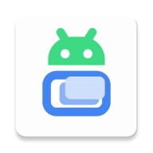

# DroidVM



[简体中文](README.zh.md) | [English](README.md)

An Android virtual machine manager with support for multiple hypervisors, including Qualcomm Gunyah, MediaTek GenieZone, and Linux KVM.

Supported hypervisors:

- Qualcomm Gunyah (`/dev/gunyah`)
- MediaTek GenieZone (`/dev/gzvm`)
- Linux KVM (`/dev/kvm`)

Create and manage lightweight VMs directly on your device with near-native performance.

## Resources

- [Repository](https://github.com/Droid-VM/DroidVM)
- [Wiki](https://github.com/Droid-VM/DroidVM/wiki)
- [Releases](https://github.com/Droid-VM/DroidVM/releases)

## Features

- **Multiple VM backend support**: [crosvm](https://crosvm.dev/) and [QEMU](https://www.qemu.org/)
- **UEFI boot** for Linux or Windows
- **GPU acceleration**: VirGL, GfxStream, and 2D software rendering
- Built-in **VNC client** for graphical display access
- **External display casting**: cast VM display to an external screen (USB Type-C, Miracast, etc.) via Android Presentation API, with the phone acting as a touchpad controller
- **Terminal console** with full ANSI/xterm emulation (via [Termux terminal libraries](https://github.com/termux/termux-app))
- Create and edit disk images in multiple formats: **raw**, **qcow2**, and more
- Disk operations: **resize**, **convert**, **clone**, **optimize**, and **delete**
- **Disk/CD-ROM download** and **LXC image import** support
- **Virtual bridge networks** with NAT, DHCP, STP, and IPv4/IPv6 support
- **Shared directories** between host and guest via VirtFS (9p)
- **Windows support** with modified VirtIO drivers
- **Linux agent operations**: change password, etc.

## Requirements

- **Android 14** (API 34) or newer
- **Root access** (Magisk, KernelSU, APatch, or similar)
- A supported ARM64 device with hardware virtualization enabled by firmware and kernel:
  - Qualcomm: **Snapdragon 7s(+) Gen 3/4** or newer SoC, **Snapdragon 8 Elite** (SM8750) recommended, with Gunyah enabled
  - MediaTek: **Dimensity 9000** or newer SoC with GenieZone enabled
  - Other ARM64 devices: booted with EL2 and Linux KVM enabled
- An available virtualization device node: `/dev/gunyah`, `/dev/gzvm`, or `/dev/kvm`

## Building

### Prerequisites

- [Android Studio](https://developer.android.com/studio) with SDK 36
- NDK with CMake 3.22.1+
- JDK 11+

### Steps

```bash
git clone https://github.com/Droid-VM/DroidVM.git
cd DroidVM
git submodule update --init --recursive
./gradlew assembleRelease
```

The built APK will be located at `app/release/`.

## License

This project is licensed under the **GNU General Public License v3.0**. See [LICENSE.txt](LICENSE.txt) for details.
